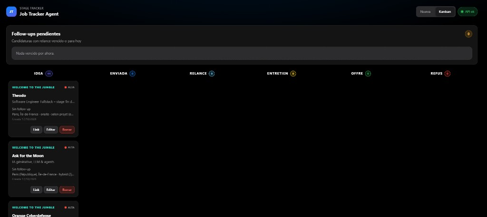
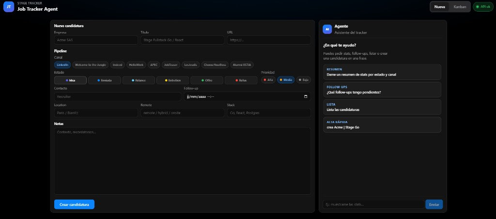

# Job Tracker Agent

App pour suivre des **candidatures de stage / job** : pipeline (idea → offre / refus), kanban, et un **agent chat** qui appelle des tools (stats, liste, due, créer, patch) sur la même API.

Utile pour ne pas perdre le fil des relances - et pour montrer un full-stack + agent LLM simple.

**Pourquoi ce projet :** apprendre en construisant une API Go réelle, un front React, Docker Compose, et un agent avec tools (rules → LLM optionnel) plutôt qu'un CRUD isolé.

**Stack:** Go (API) · Postgres · React · Docker Compose  
**Optionnel:** LLM OpenAI-compatible (sinon le chat tourne en mode *rules*)  
**Outil:** développé et brainstormé avec [Cursor](https://cursor.com)






## Lancer

```bash
cp .env.example .env
# édite APP_API_KEY + mot de passe Postgres

docker compose up --build -d
```

| Service | URL |
|---------|-----|
| UI | http://localhost:3847 |
| API | http://localhost:8088 |

## Utiliser

1. **Kanban** - colonnes par status, drag & drop, follow-ups
2. **Nueva** - formulaire + chat agent
3. Auth = `APP_API_KEY` (Bearer ; déjà dans le frontend Compose)

Sans `LLM_API_KEY`, le chat comprend des phrases type *stats*, *lista*, *due*, *crea Acme  Stage Go*.

## Dev local (optionnel)

```bash
# API (:8088) - DATABASE_URL + APP_API_KEY
cd backend && go run ./cmd/server

# UI (:5173)
cd frontend
cp .env.example .env   # VITE_API_URL + VITE_API_KEY
npm install && npm run dev
```

## Tests

```bash
cd backend && go test ./...
cd frontend && npm ci && npm run build
```

CI GitHub Actions: `.github/workflows/ci.yml` (tests Go + build React).

## Vérifier

Voir [SMOKE.md](./SMOKE.md) - checklist UI + `.\scripts\smoke.ps1`

## Notes

- LLM: `LLM_API_KEY` / `LLM_BASE_URL` / `LLM_MODEL`
